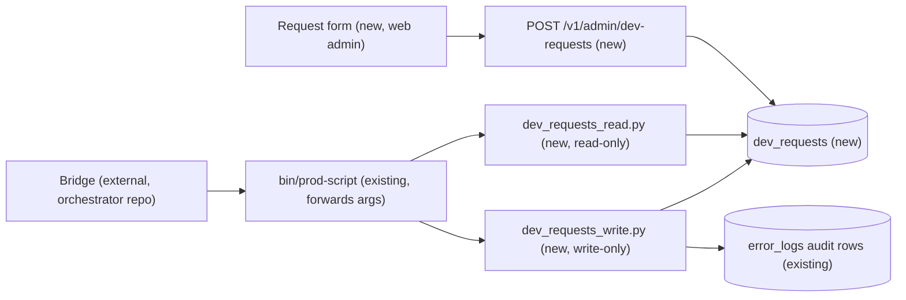

<!-- human.md — the succinct human-readable digest of this stage. Mermaid
     first, prose second; every diagram must carry real content, not
     decoration. Refreshed by the stage before its gate runs, held to
     docs/RENDER-STYLE.md (`devx render lint 1e84ad design`). -->

# design — Admin Request Intake (human digest)

## Reading guide

| Section | What it covers | pm | architect | dev | qa |
| --- | --- | :-: | :-: | :-: | :-: |
| Overview | what ships, in what order | ● | ● | ● | ● |
| Architecture | which pieces are new and how one request moves | ○ | ● | ● | |
| Interfaces | what the bridge calls and what comes back | | ● | ● | ○ |
| Data | what the table holds and enforces | | ● | ● | ○ |
| Widening surfaces | what the panel and the list, detail and cancel routes add | ○ | ○ | ● | ○ |
| Verification harness | how the tests prove the path before it exists | | ○ | ● | ● |
| Migration plan | how this reaches production safely | ○ | ○ | ● | ○ |
| Risks | what could go wrong, and what catches it | ● | ○ | ○ | ● |

## Overview

Palateful's half of the request pipeline. First a thin slice: an admin files
a request, the laptop bridge sees only its id and hash, Leo adopts it, and
the text crosses to the laptop once. Then the panel and progress tracking.
Then faults from the running system, and the bookkeeping that lets items
move between workstreams.

## Architecture

- **One table** owns the status set, the text normalization and the hash.
- **One endpoint** normalizes, hashes and stores; it can only create
  `submitted` rows.
- **Two scripts.** The read script holds no write SQL; the write script
  changes one row per call, under a lock, with an audit row.
- **Self-contained scripts.** They import only the standard library,
  SQLAlchemy and `utils.constants`, because the script that runs is
  `main`'s while the image may be older.

## Interfaces

- **Calls.** `bin/prod-script <script> <command> [args]`. Read: `poll`,
  `adopt`, `show` (Leo only), `metrics`; later `faults`, `fault-adopt`.
  Write: `transition`; later `open-fault`, `move`.
- **Records.** One `DEVREQ1 {json}` line each, pure ASCII, then one `end`
  line with a count. A run without a clean `end` changed nothing.
- **Errors** are fixed codes, never exception text, which could carry row
  data.

## Data

- **Columns.** Title, body and done-when (normalized, never edited), a hash
  over all three, status, source (admin or fault), workstream, PR links,
  timestamps.
- **Enforced by the database.** Lengths, the 13 statuses, the hash shape,
  and at most one open row per fault signature.
- **Audit.** Every applied change writes one `error_logs` row tagged
  `audit`.

## Widening surfaces

- **List, detail, cancel.** Shaped like the feedback inbox. Only the detail
  route returns the text; cancel works only for the submitter, before
  adoption.
- **Panel screens** with a status chip per request and two staleness hints,
  timed against the server's clock.
- **Progress fields** from the bridge: a fixed template per detail code, PR
  links stored once each.

## Verification harness

- **Real Postgres**, a throwaway database per run, built from the models in
  under a second.
- **Real `bin/prod-script`**, with `aws` swapped for a shim that reproduces
  the noisy ECS stream.
- **Wrappers that cannot be fooled.** They run pytest without the coverage
  gate, pin the hash of every test file they run, and report a broken
  harness as a wrong reason rather than as RED.

## Migration plan

- **One migration** adds the table; CI runs migrations before it deploys
  the API.
- **`bin/prod-script`** stays compatible with every existing call.
- **A script ahead of its table** fails cleanly and changes nothing.

## Risks

| Risk | Caught by |
| --- | --- |
| Request text reaches the laptop early | canary test, with a control that proves it can see |
| Stream noise corrupts a record | the shim, plus the `end` count |
| Two writers race on one row | compare-and-set with an explicit `from` |
| Invisible characters change meaning | normalization and the hash |
| Fault text carries a caller's words | server-chosen fields only |

## Constraints · Assumptions · Out of scope · Discarded

- **Constraints.** The laptop reaches the database only through
  `bin/prod-script`; prod has no `DATABASE_URL` variable; the merge is the
  deploy.
- **Assumptions.** The ECS stream merges stderr; prod traces name container
  paths.
- **Out of scope.** The bridge, the router, split and combine.
- **Discarded.** `fetch_feedback.py` as the tap, an API credential for the
  bridge, text-based routing.
