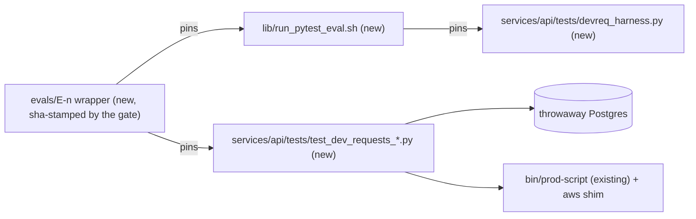

<!-- human.md — the succinct human-readable digest of this stage. Refreshed
     by the stage before its gate runs, held to docs/RENDER-STYLE.md
     (`devx render lint 1e84ad evals`). -->

# evals — Admin Request Intake (human digest)

## What runs before any code exists

| Eval | Proves | Fails today because |
| --- | --- | --- |
| Whole path | a request goes submitted → received → accepted through the real channel | arguments are not forwarded; no table; no scripts |
| No text before adoption | pre-adoption calls carry none of three canaries | no table, so no request to poll |
| Only the operator adopts | the API creates only submitted rows, for the caller | the create route does not exist |
| Validated transitions | legal edges apply once with an audit row; everything else is refused | no table; no write script |
| Normalization | stored text and hash match the reference | no table; no create route |

## Controls that prove the evals can see

- **The channel runs today.** A no-argument `bin/prod-script` call passes
  through the shim and the real prelude.
- **The API harness works today.** An existing admin route answers 200 for
  an admin and 403 for a non-admin on the throwaway database.
- **The canary detector sees a canary** in a record built with one, and,
  once the scripts exist, in a real adopt.
- **The route scan finds** an existing route before it looks for the new
  one.

## What the wrappers refuse

- **An edited test, harness or runner:** `EVAL-TAMPERED`, exit 3.
- **A broken environment** (database down, collection error, a skip, fewer
  tests than declared): `EVAL-WRONG-REASON`, exit 3.
- **Measured today:** all three tamper cases and a database on a dead port
  each exit 3.

## Not run yet

- **Rate limit, panel screens, list and cancel, progress fields, faults,
  routing writes** — tests written with their phase.
- **The live walkthrough** — a human checklist, run once the bridge is
  installed.
