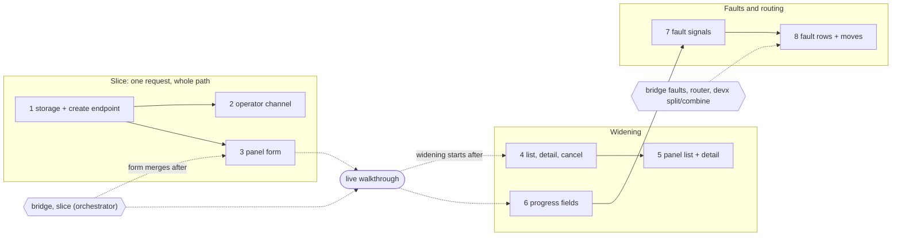

<!-- human.md — the succinct human-readable digest of this stage. Refreshed
     by the stage before its gate runs, held to docs/RENDER-STYLE.md
     (`devx render lint 1e84ad plan`). -->

# plan — Admin Request Intake (human digest)

## The slice

- **Phase 1 — storage and the create endpoint.** The table, its rules, and
  the one route an admin uses to file a request.
- **Phase 2 — the operator channel.** `bin/prod-script` learns to pass
  arguments; two scripts let the bridge poll, adopt and record changes.
  The riskiest phase: every ops session uses `bin/prod-script`, and this is
  the contract another repo builds on.
- **Phase 3 — the form.** A dashboard tile and a three-field form. It
  merges only once the bridge is listening, or requests would wait unseen.
- **Done when** Leo files a request in production and adopts it from the
  laptop, end to end.

## The widening

Starts only after the slice works live.

- **Phase 4** — list, detail and cancel routes.
- **Phase 5** — the panel's list and detail screens; detail replaces the
  terminal read.
- **Phase 6** — the fields the bridge uses to report progress.

## Faults and routing

- **Phase 7** — server errors as capped, text-free signals, and the one
  call that returns a fault's samples at adoption.
- **Phase 8** — an adopted fault becomes a tracked row; any row can move to
  follow its work when workstreams split or combine.

## Waiting on other repos

| Gate | Repo | Holds |
| --- | --- | --- |
| Bridge, slice | orchestrator | the form's merge; the live walkthrough |
| Bridge, widening | orchestrator | progress reporting in practice |
| Bridge, faults | orchestrator | live use of fault signals |
| Router | orchestrator | live use of moves |
| Split and combine | devx | splitting; a human may choose the partition |

## Rollback

- **Revert-safe:** every phase's code. Old `bin/prod-script` calls keep
  working.
- **Not revert-safe after real data:** the migration, once a real request
  exists. From then on, forward migrations only.
