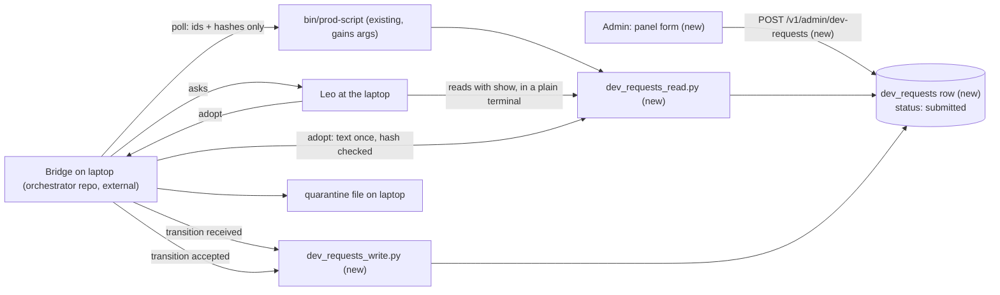

<!-- human.md — the succinct human-readable digest of this stage. Mermaid
     first, prose second; every diagram must carry real content, not
     decoration. When <stage>/outline.md exists its structure IS this file's
     structure (the outline dictates the shape; agent.md keeps the gate
     sections). Refreshed by the stage before its gate runs. -->

# prd — Admin Request Intake (human digest)

## What ships first

A thin slice that proves one request can travel the whole path:

- **One row.** A new `dev_requests` table, with every status the pipeline
  will ever need already allowed.
- **One endpoint.** Any admin can file a request: title, body, optional
  "done when". The server normalizes the text and hashes it.
- **One poll.** The bridge sees ids, statuses and hashes. Never text.
- **One adopt.** Leo says yes at the laptop. The bridge fetches the text
  once, checks the hash, quarantines it, and marks the row `accepted`.
- **One form.** A "Request a change" screen on the admin dashboard.

## What widens after it works

- **Panel list and detail** with status chips and staleness hints. The
  detail screen replaces the terminal read.
- **List and cancel endpoints** for admins.
- **Pipeline progress** written back by the bridge: scoping through
  shipped, and "waiting on Leo" with a reason.

## Faults, after that

The running system becomes a second source:

- **Signals, not text.** Server errors grouped by a stable signature:
  service, error type, route template, code locations, count. No message,
  trace or raw path, because those echo what callers sent.
- **Bounded.** At most 50 signatures a poll, the rest summed into one
  overflow record.
- **Adopted the same way.** Leo adopts a fault; its samples cross to the
  laptop once, and it becomes a tracked row.

## Routing

Items join existing workstreams instead of each getting its own:

- **Fit or create** at adoption, proposed from shared files, confirmed by
  Leo.
- **Split and combine** need new devx primitives; Palateful only moves each
  row to follow its work.
- **Never from text.** Code locations decide. Hub files like
  `dependencies.py` never count.

## The contract with the bridge

The bridge lives in the orchestrator repo, outside this workstream. It is
built against a fixed contract:

- **Channel.** `bin/prod-script`, which now forwards arguments. It needs the
  laptop's AWS keys, so only the laptop can adopt.
- **Framing.** Every record line starts `DEVREQ1 `, and every run ends with
  one `end` record. A run without one changed nothing.
- **Reads.** `poll` and `metrics` carry no submitter text. `adopt` carries
  it once.
- **Writes.** `transition <id> <from> <to>` is compare-and-set, takes only
  enums, ids and hashes, and writes one audit row per change.
- **Bridge duties.** Run only `origin/main` copies of the scripts. Never call
  `show`. Keep text out of events, the ledger and its own state.

## Who decides

- **Any admin** may file.
- **Only Leo, at the laptop,** may adopt or decline.
- **Leo merges** every PR by hand. Deploys are automatic on merge, so the
  merge is the last human step before production.

## Not in this workstream

- **The bridge and the router**, and anything else in the orchestrator
  repo; **split and combine** in devx.
- **AWS-side fault sources** and client-reported errors.
- **Auto-adopt or auto-merge.**
- **The later brakes:** a CI request guard, a credential-free request tab,
  separate identities.
- **Reusing feedback or meal suggestions** for requests.
