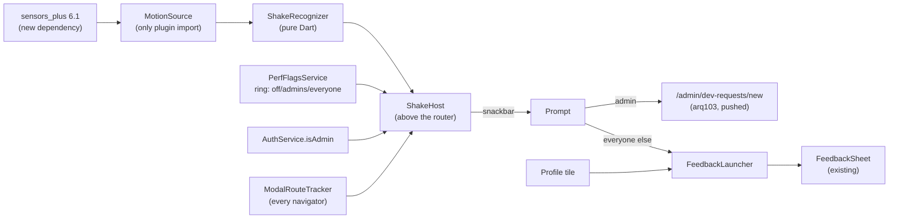
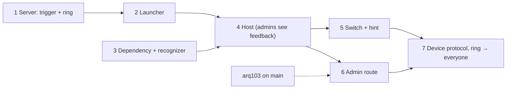

<!-- human.md — the succinct human-readable digest of this stage. Mermaid
     first, prose second; every diagram must carry real content, not
     decoration. When <stage>/outline.md exists its structure IS this file's
     structure (the outline dictates the shape; agent.md keeps the gate
     sections). Refreshed by the stage before its gate runs, held to
     docs/RENDER-STYLE.md (`devx render lint <hash> design`). -->

# design — Shake To Report (human digest)

## Reading guide

| Section | What it covers | pm | architect | dev | qa |
| --- | --- | :-: | :-: | :-: | :-: |
| Overview | what a shake does, and for whom | ● | ● | ● | ● |
| Recognizer | what counts as a shake, and why knocks and walking do not | ○ | ● | ● | ● |
| Host | where the trigger lives, when it listens, what it refuses | ○ | ● | ● | ● |
| Modal-route tracking | how it knows a dialog or sheet is open on any tab | | ● | ● | ○ |
| Feedback launcher | how shake and Profile share one opener and one flush | | ○ | ● | ○ |
| Rollout ring and switch | how Leo and a user turn it off | ● | ● | ● | ○ |
| Interfaces | which seams change | | ● | ● | ○ |
| Data | what is stored where | | ○ | ● | |
| Migration plan | the order that never loses feedback | ● | ● | ● | ○ |
| Risks | what could go wrong, and what proves it does not | ● | ○ | ○ | ● |
| Out of scope · Assumptions · Discarded | the edges | ○ | ○ | ○ | ○ |

## Overview

A shake shows a prompt; only a tap opens a form. The host above the
router decides whether to listen, whether the user is busy, and where a
tap goes. Profile and shake share one feedback opener.

## Recognizer

A shake is four back-and-forth reversals, each peak at 2 g or more,
70–500 ms apart. Walking cannot do it: the down half of a step is at most
free fall, 1 g. A knock is one peak with fast ringing. Plain Dart, so
synthesized traces test it; all numbers sit in one tuning constant. A
missing or failing sensor stops it quietly for the session.

## Host

Wraps the router inside `MaterialApp.router`'s builder.

- **Listens** only on iOS and Android, signed in, ring and switch
  allowing, app in foreground.
- **Refuses** while a text field has focus, a dialog or sheet is open on
  any navigator, or its own prompt, sheet or the dev-request form is up.
- **Prompts** with a 4-second floating snackbar; two ignored in a row mute
  it until next launch.
- **On a tap** it pushes, never replaces, so the screen underneath keeps
  its timers and typed text. Admin only if admin at prompt and tap, and
  only if the route exists; otherwise feedback.

## Modal-route tracking

One observer added to the root navigator and to each tab's navigator
knows when a dialog or sheet is on top, covering the app's 82 call sites
without touching them.

## Feedback launcher

Profile's opener and offline flush move into one launcher. It sends the
real route and the trigger. The app flushes the queue at startup and on
every resume, so feedback queued anywhere gets sent.

## Rollout ring and switch

- **Ring:** a terraform variable, default `admins`, served on the flags
  endpoint the app already polls every 5 minutes. A failed fetch keeps the
  last value, never widens.
- **Switch:** `Shake to report` in Profile settings, on by default.
- **Hint:** the Send Feedback subtitle mentions shaking, non-admins only.

## Interfaces

Flags response gains `shake_report`; the feedback context gains `trigger`;
the admin route is imported from arq103, not copied.

## Data

No migration. Two device keys (ring, switch), one terraform variable, and
a `trigger` inside the existing feedback JSON.

## Migration plan

The server goes first because a client that sends `trigger` early loses
feedback silently. The ring starts at `admins`, so admins dogfood the host
before anyone else sees it.

## Risks

False triggers, interruptions, a wrong role, a broken native build, lost
feedback, an off switch undone by a deploy, battery. Each maps to an eval
in `agent.md` § Risks.

## Out of scope · Assumptions · Discarded

- **Out:** the form itself, web, screenshots, the Android toolchain.
- **Assumed:** arq103's path and pop stay as they are; 2 g fits real
  shakes; no iOS motion prompt. The device protocol checks the last two.
- **Discarded:** cook-mode suppression, a choice for admins, a second
  gesture, coach marks, a fresh `/me` per shake.
