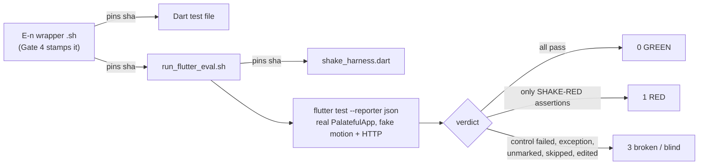

<!-- human.md — the succinct human-readable digest of this stage. Mermaid
     first, prose second; every diagram must carry real content, not
     decoration. When <stage>/outline.md exists its structure IS this file's
     structure (the outline dictates the shape; agent.md keeps the gate
     sections). Refreshed by the stage before its gate runs. -->

# evals — Shake To Report (human digest)

## What each P0 does today

On unbuilt code, nothing subscribes to motion, so no shake ever prompts.

- **User path:** RED. "A deliberate shake showed 0 prompts; motion
  listeners=0", in both its tests.
- **Everyday motion:** RED, but not for its own claim: 0 false
  triggers is free when nothing listens. It fails because its closing
  deliberate shake cannot prompt, and it says so by name.
- **No interruption:** RED the same way in its four busy states,
  plus its timer test, which needs a first prompt.
- **Role and ring:** RED in seven tests, one of them for the external
  gate: arq103's route is not on `main`.

## Why a RED here means something

- **Controls pass first.** Each file proves the harness can boot the real
  app, deliver motion on sensors_plus's channel, find a prompt-shaped
  snackbar, and find the sheet Profile opens.
- **Only named failures count.** A failure without a `SHAKE-RED[...]`
  marker, or an exception, is "broken", not RED.
- **The runner was tested against itself:** a tampered test, a typo in the
  harness's channel, an exception, an unmarked assertion and a compile
  error each give "broken". The channel typo first passed, which is how
  the motion control was found too weak, and fixed.
- **Green is reachable.** A throwaway host, never committed, turned the
  user-path and everyday-motion evals green and the timer test green, and
  made the busy states and the ring cases fail by their own names.

## Not covered by a P0

Web, missing sensors, the server's ring and trigger, the launcher's flush,
the switch and hint, and the tap paths are P1/P2 tests written with their
phases. The real-phone protocol is a human eval run on a release build.
