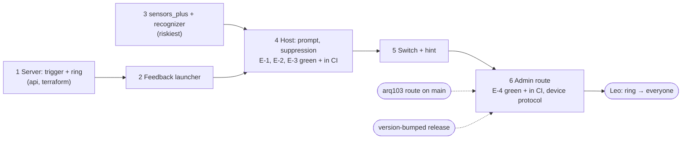

<!-- human.md — the succinct human-readable digest of this stage. Mermaid
     first, prose second; every diagram must carry real content, not
     decoration. When <stage>/outline.md exists its structure IS this file's
     structure (the outline dictates the shape; agent.md keeps the gate
     sections). Refreshed by the stage before its gate runs. -->

# plan — Shake To Report (human digest)

## Six phases, one PR each

1. **Server first.** The feedback context accepts `trigger`; the flags
   endpoint serves the ring; terraform sets it to `admins`.
2. **One launcher.** Profile's feedback opener and offline flush move into
   one place; queued feedback now sends from any screen.
3. **The dependency, alone.** sensors_plus 6.1, the iOS motion key, and the
   recognizer, tested with synthesized traces. Nothing listens yet.
4. **The host.** Prompt, suppression, feedback for everyone the ring lets
   in. Ring is `admins`, so admins dogfood it. Three P0 evals go green and
   start running in CI.
5. **Controls.** The Profile switch and the hint.
6. **Admins.** The dev-request form, once arq103 is on `main`. The fourth
   P0 goes green; Leo runs the device protocol.

## Riskiest: phase 3

Nothing at PR time builds iOS or Android, so a plugin that breaks either
build would surface at release. The phase must build both locally and
paste the result. Its `pubspec.yaml` edit also fires Xcode Cloud: without a
version bump, expect one failed run. Whether to bump is Leo's call.

## What a revert can't undo

A revert fixes `main`, not phones. Phases 4–6 have a field off switch (the
ring). Phases 2–3 don't, so they must behave as before. Removing `trigger`
from the server after a release sends it would silently lose feedback.

## Waiting on others

- **arq103's route on `main`**: held behind admin-request-intake's own
  bridge. Until then admins get feedback.
- **A release**: client phases reach phones only in a version-bumped build.
- Leo may widen the ring after phase 5 instead of waiting for phase 6.
