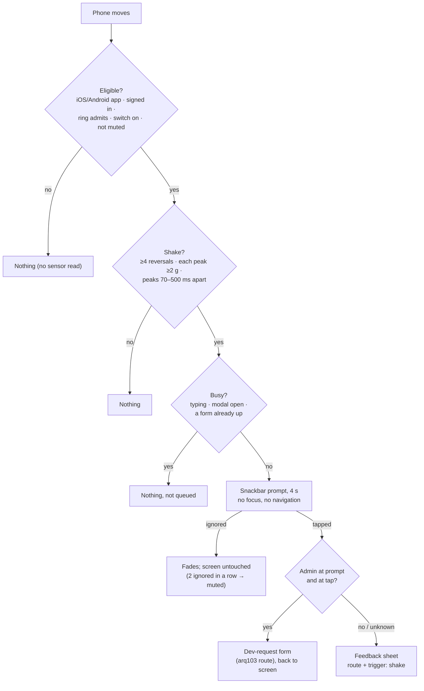

<!-- human.md — the succinct human-readable digest of this stage. Mermaid
     first, prose second; every diagram must carry real content, not
     decoration. When <stage>/outline.md exists its structure IS this file's
     structure (the outline dictates the shape; agent.md keeps the gate
     sections). Refreshed by the stage before its gate runs. -->

# prd — Shake To Report (human digest)

## The one idea

A false shake must cost nothing. So a shake never opens a form: it shows a
small prompt that fades in 4 seconds, and only a tap opens anything. While
someone is typing, has a dialog up, or already has a form open, a shake
does nothing at all.

## Who gets what

- **Admin on a phone:** `File a dev request?` → the dev-request form, then
  back where they were.
- **Everyone else:** `Send feedback?` → the existing feedback sheet, which
  now records the screen and that it came from a shake.
- **Role unknown** (offline launch, `/me` failed): the user path. The
  admin form is never the fallback; the server still refuses non-admins.

## Where it does not run

Web, E2E builds, signed-out screens, phones with no motion sensor. No
permission prompt anywhere.

## Off switches

- **Ring, server-side:** `off` / `admins` / `everyone`, a terraform
  variable. Starts at `admins` so Leo dogfoods; no app release to change.
- **Per device:** `Shake to report` in Profile settings, on by default.
- **Automatic:** two ignored prompts in a row mute it until next launch.

## Without shaking

Profile → Send Feedback; Profile → Admin Dashboard → Request a change.
Both stay. For non-admins the feedback tile mentions the shake; admins get
no hint.

## Two traps this PRD closes

- The server rejects unknown feedback context keys and the sheet re-queues
  on any error, so `trigger` must reach the server before any client sends
  it, or shake feedback is silently lost forever.
- Queued offline feedback only sends while Profile is on screen today, so
  one shared launcher moves the flush app-wide.

## Open, with defaults taken

Ring starts at `admins`; switch defaults on; admins get only `Request`;
the shake thresholds are tuned on real phones in the device protocol.
